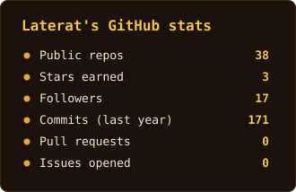
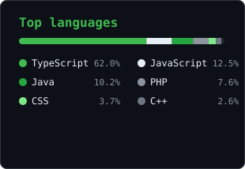

 <!--
  GitHub Profile README
  Owner: Latera Tilahun Mekonnen
-->

<!-- ==================== HERO ==================== -->

<p align="center">
  
</p>

<h1 align="center">Hi, I'm Latera 👋</h1>

<h3 align="center">
  Computer Science Student · Full-Stack Developer · Problem Solver
</h3>

<p align="center">
  <a href="https://github.com/Laterat">
    
  </a>
</p>

<p align="center">
  <a href="https://github.com/Laterat">
    
  </a>
  
  <a href="https://github.com/Laterat?tab=followers">
    
  </a>
</p>

---

<!-- ==================== ABOUT ==================== -->

## `01 / About me`

I'm a Computer Science student at **Addis Ababa University**, interested in building practical software systems and understanding how things work under the hood.

I enjoy working across the stack, from designing interfaces to developing backend services, modeling databases, and solving problems through software.

```ts
const latera = {
  name: "Latera Tilahun Mekonnen",
  education: "Computer Science @ Addis Ababa University",
  location: "Addis Ababa, Ethiopia",

  interests: [
    "Full-Stack Development",
    "Backend Engineering",
    "Database Design",
    "Systems & Networking",
  ],

  currently: "Building and improving real-world applications",

  philosophy: "Learn deeply. Build carefully. Improve continuously.",
};
```

---

<!-- ==================== TECH STACK ==================== -->

## `02 / Tech stack`

**Languages & Core Technologies**

<p>
  
</p>

**Frontend & Backend**

<p>
  
</p>

**Databases & Tools**

<p>
  
</p>

---

<!-- ==================== PROJECTS ==================== -->

## `03 / Selected projects`

A selection of projects that reflect my experience with application development, database design, and problem-solving.

<table>
  <tr>
    <td width="50%" valign="top">
      <h3>🛒 SnapMart</h3>
      <p>
        A full-stack e-commerce platform with a separate frontend and backend, designed to support online shopping workflows.
      </p>
      <p>
        <strong>Stack:</strong><br/>
        <code>TypeScript</code> <code>Full-Stack</code>
      </p>
      <a href="https://github.com/Laterat/snapmart">Source code →</a>
      &nbsp;·&nbsp;
      <a href="https://snapmart-eta.vercel.app">Live demo →</a>
    </td>
    <td width="50%" valign="top">
      <h3>💊 ASD Pharmacy Management</h3>
      <p>
        A pharmacy management and POS system featuring role-based access, CSRF protection, and batch-aware inventory deduction based on earliest expiry.
      </p>
      <p>
        <strong>Stack:</strong><br/>
        <code>PHP</code> <code>MySQL</code> <code>Vanilla JS</code>
      </p>
      <a href="https://github.com/Laterat/pharmacy_managemnt_system">Source code →</a>
    </td>
  </tr>
  <tr>
    <td width="50%" valign="top">
      <h3>🏥 Hospital Queue Management</h3>
      <p>
        A console-based hospital queue management system with role-based access and emergency patient prioritization using data structures.
      </p>
      <p>
        <strong>Stack:</strong><br/>
        <code>C++</code> <code>Linked Lists</code> <code>Circular Queues</code>
      </p>
      <a href="https://github.com/Laterat/Hospital-Queue-Management">Source code →</a>
    </td>
    <td width="50%" valign="top">
      <h3>🥬 Door-to-Door Grocery</h3>
      <p>
        A desktop grocery delivery management system with dedicated interfaces for customers, delivery agents, managers, and administrators.
      </p>
      <p>
        <strong>Stack:</strong><br/>
        <code>Java</code> <code>Java Swing</code> <code>JDBC</code> <code>SQL Server</code>
      </p>
      <a href="https://github.com/Laterat/Door-to-Door-Grocery-MS">Source code →</a>
    </td>
  </tr>
</table>

<p align="center">
  <a href="https://github.com/Laterat?tab=repositories">
    <strong>Explore all my repositories →</strong>
  </a>
</p>

---

<!-- ==================== GITHUB ANALYTICS ==================== -->

## `04 / GitHub analytics`

<p align="center">
  
  &nbsp;
  
</p>

<p align="center">
  
</p>

---

<!-- ==================== CONNECT ==================== -->

## `05 / Let's connect`

I'm interested in connecting with developers, collaborating on meaningful projects, and exploring internship opportunities.

<p align="center">
  <a href="https://github.com/Laterat">
    
  </a>
  <a href="https://www.linkedin.com/in/latera-mekonnen/">
    
  </a>
  <a href="mailto:mekonnenlatera@gmail.com">
    
  </a>
</p>

<p align="center">
  <i>"Great software is built through curiosity, consistency, and attention to detail."</i>
</p>

<p align="center">
  
</p>
